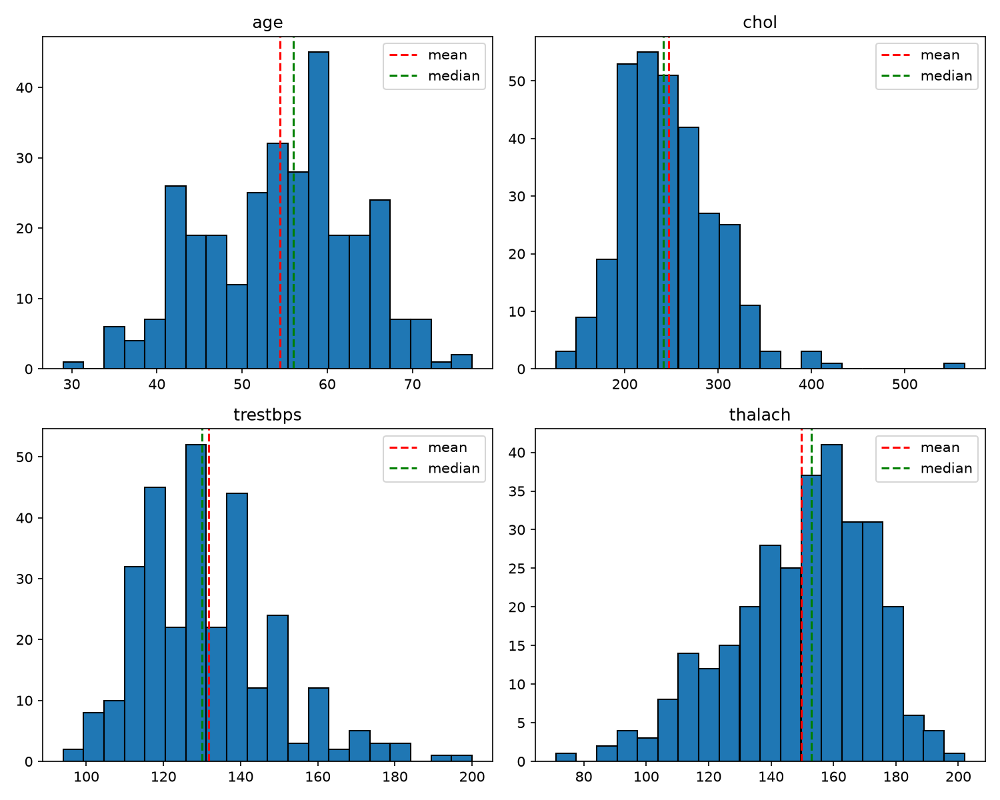
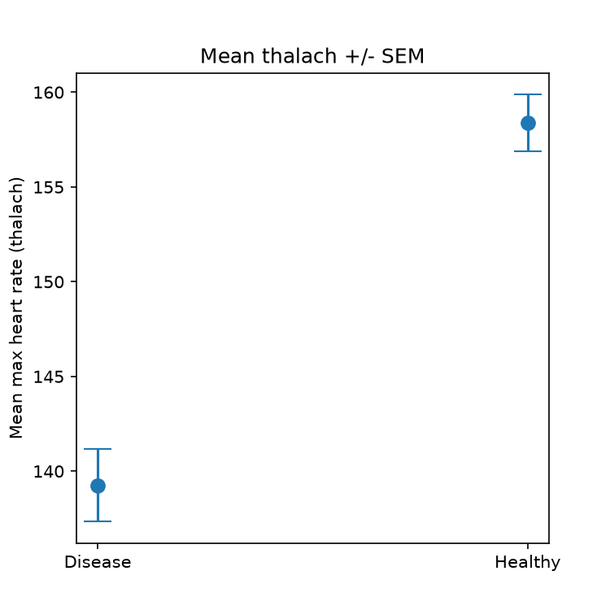
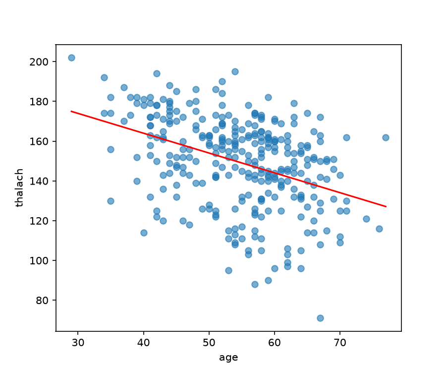
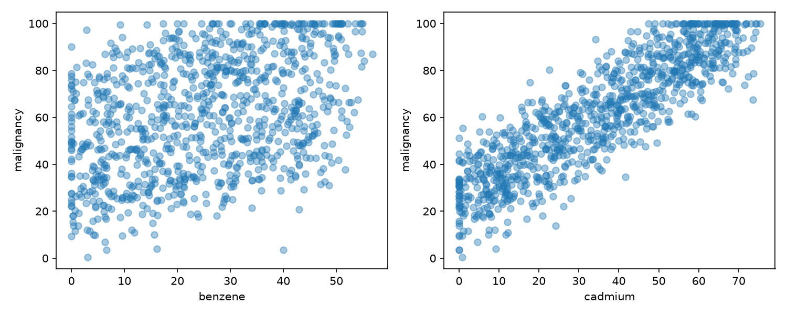

# CSPC - Computer Science for Physics and Chemistry

My coursework repository. Each practical is under PW<n>/Lab <X>/.

## Setup

Create the environment for a given lab:

    conda env create -f PW<n>/Lab\ <X>/environment.yml
    conda activate cspc

---

## PW1 - Lab A: Reproducible Foundations

**What I built:**
- A Git repository (CSPC) published on GitHub, with a conda environment file (environment.yml) so the project can be rebuilt on any machine.
- A radioactive decay simulation with two versions (pure-Python loop and NumPy), three pytest tests, and a script (speed.py) that compares their speed.

**Speed comparison (loop vs NumPy):**
- loop    : 1.9328 s
- numpy   : 0.0002 s
- speed-up: 11439.4x faster

**Tests:** all passing? yes

**Conclusion:**
- The NumPy version was about ten thousand times faster than the loop. The loop makes one random draw for every atom at every time step, while NumPy makes one binomial draw per step for the whole sample.
- The tests showed the simulation behaves correctly: it starts at N0, rejects a negative rate, and the average over many seeds matches N0*exp(-lam*t).
- Using Git branches, a remote on GitHub and an environment.yml file made the work organised and reproducible. (Add any problem you actually had, for example the GitHub token login or a conda error, or write that there were none.)

## PW1 - Lab B: Data, Plotting, and Automation

**What the data showed:**
- The observed count starts at N0 = 5000 at t = 0 and falls quickly at first, then more slowly, reaching almost zero by t = 15-20. This is the shape of exponential decay.

**Observed vs analytical law:**
- The observed points follow the analytical curve N0*exp(-0.3 t) closely. Both start at 5000, drop at the same rate, and flatten out near zero at the same time. For example, at t = 5 the curve gives about 1100 and the observed value is also about 1100. The small differences are random scatter, which is expected because decay is a random process. So the data matches the law with lambda = 0.3.

**Snakemake pipeline:**
- The Snakefile has one rule that rebuilds figure.png from decay_observed.csv and plot.py by running plot.py. It only reruns when an input is newer than the output, and otherwise reports that nothing needs doing.

## PW2 --- Lab A

**Mean acceleration measured:** -8.58 m/s² (std = 28.7 m/s²). The sign and size are consistent
with free fall at -9.81, but the noise pulls the mean away from the exact value.

**Why the acceleration is noisy:** A derivative divides the difference between neighbouring
measurements by a small time step (0.1 s), so small random errors in the position get
magnified; doing this twice magnifies them again, which is why the acceleration is far
noisier than the position.

**What integrating back showed:** integrating the noisy acceleration twice recovered the
position to within 0.78 m of the original (max difference), showing that integration
suppresses noise while differentiation amplifies it.

## PW3 --- Data, Distributions, Testing, and Causation

**Data:** Heart Disease (Cleveland), 303 patients, source UCI / Kaggle; and the synthetic `chemicals_cancer.csv`, 1000 patients.

### Session 1

**Shapes:** `age` is roughly bell-shaped with a slight left skew; `chol` is strongly right-skewed with outliers (max 564); `trestbps` is right-skewed; `thalach` is left-skewed (long tail of low values).

**Normality verdicts:** Shapiro-Wilk rejects normality for all four (p = 0.006, 6e-9, 2e-6, 7e-5). With n = 303 the test is very sensitive, so I also used Q-Q plots and skewness: `age` and `thalach` are only mildly non-normal, while `chol` (skew 1.13, kurtosis 4.4) and `trestbps` are clearly non-normal. I treated all four as not normal and used non-parametric methods in Session 2.

### Session 2: Heart data

**Heart rate, disease vs healthy:** I used the Mann-Whitney U test because thalach is not normal (U = 5806.5, p = 1.9e-13; Welch's t-test agrees, p = 9e-14). Heart-disease patients reach a significantly lower maximum heart rate.

**Means and uncertainty:** disease 139.3 +/- 1.9 (SEM), healthy 158.4 +/- 1.5 (SEM). The means are about 7 standard errors apart and the error bars do not overlap, so the picture agrees with the test.

**Age vs thalach:** Pearson r = -0.39, Spearman rho = -0.39. Older patients tend to have a lower maximum heart rate, a moderate negative association (not proof of cause).

**Bonus:** entropy of `target` = 0.995 bits (max 1), almost perfectly balanced and hard to guess; `sex` = 0.905 bits (68% / 32%), more lopsided.

### Chemical mystery

**Naive conclusion:** cadmium (r = 0.88) looks far more strongly linked to malignancy than benzene (r = 0.39), so cadmium appears to be the cause.

**Looking again:** `pollution_index` correlates with cadmium (0.98) and malignancy (0.90) but not benzene (0.05), so it could be a confounder. Restricting to patients with similar pollution (slices 40-55, 55-70, 70-85) gives benzene r = 0.69 / 0.78 / 0.80, but cadmium only r = 0.14 / 0.20 / 0.20.

**Conclusion:** **benzene is the real cause.** Its association survives (and strengthens) when pollution is held roughly constant, while cadmium's collapses: cadmium only looked guilty because it tracks pollution, which drives malignancy. The small leftover cadmium correlation is because each slice still lets pollution vary a little.

